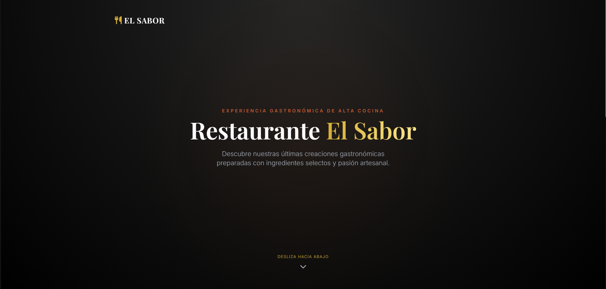
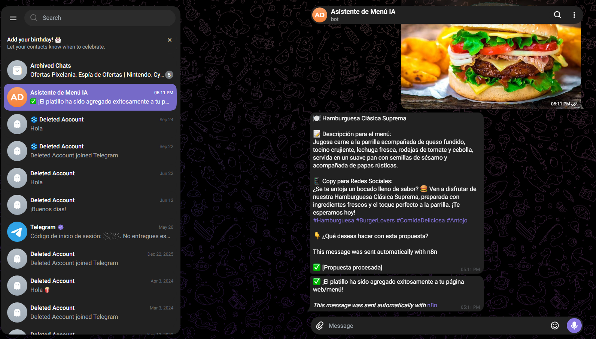
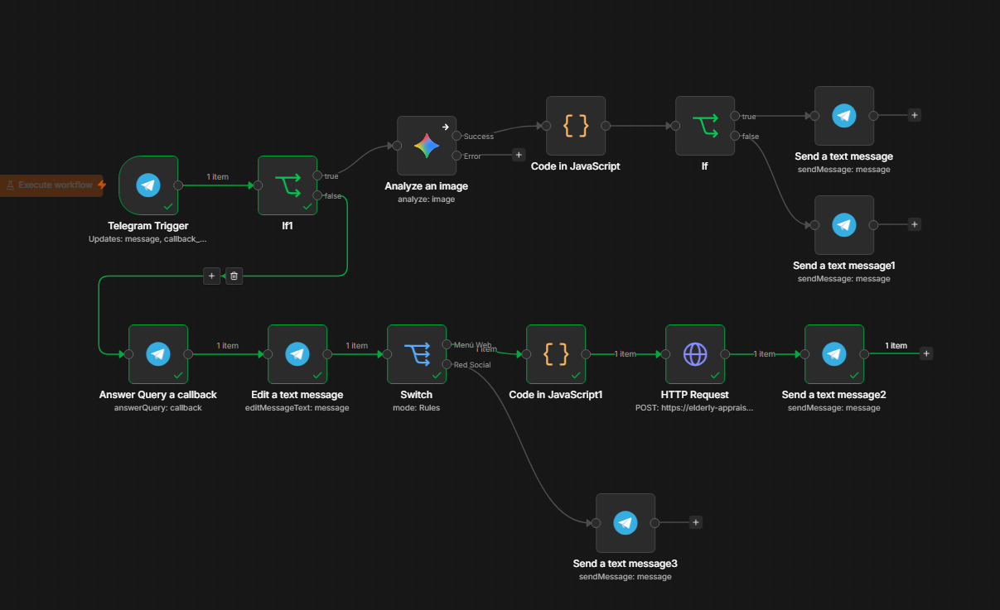
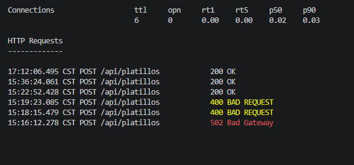

---

# 🍽️ El Sabor — Automatización Inteligente de Menús y Redes Sociales con IA & Telegram

> **Una solución integral y moderna diseñada para restaurantes que automatiza la actualización de su menú web en tiempo real y optimiza su estrategia de marketing digital mediante Inteligencia Artificial y un bot de Telegram.**

---

## 📌 Tabla de Contenidos

1. [Descripción del Proyecto](https://www.google.com/search?q=%23-descripci%C3%B3n-del-proyecto)
2. [Problema vs. Solución](https://www.google.com/search?q=%23-problema-vs-soluci%C3%B3n)
3. [Demostración Visual (Capturas de Pantalla)](https://www.google.com/search?q=%23-demostraci%C3%B3n-visual-capturas-de-pantalla)
4. [Arquitectura y Diagrama del Sistema](https://www.google.com/search?q=%23-arquitectura-y-diagrama-del-sistema)
5. [Explicación Detallada del Flujo en n8n](https://www.google.com/search?q=%23-explicaci%C3%B3n-detallada-del-flujo-en-n8n)
6. [Stack Tecnológico](https://www.google.com/search?q=%23-stack-tecnol%C3%B3gico)

---

## 💡 1. Descripción del Proyecto

**El Sabor** resuelve la fricción operativa diaria de los negocios gastronómicos. Usando una interfaz tan cotidiana como **Telegram**, los administradores o cocineros pueden enviar la fotografía de un nuevo platillo y dejar que la IA se encargue de todo el trabajo pesado: redactar una descripción atractiva para los comensales, publicarla instantáneamente en la página web del restaurante y generar el contenido listo para copiar y pegar en redes sociales.

---

## 🎯 2. Problema vs. Solución

* **El Problema Tradicional:** Actualizar los menús web suele requerir intervención de desarrolladores, uso de paneles de administración complejos y lentos, además de horas de planeación para redactar publicaciones de marketing eficaces.
* **Nuestra Solución:** Un flujo 100% automatizado, ágil y de baja fricción que opera directamente desde el celular a través de un chat de Telegram.

---

## 📸 3. Demostración Visual (Capturas de Pantalla)

*(Sube tus capturas a una carpeta llamada `img/` en tu repositorio y reemplaza los nombres de archivo según corresponda)*

### A. Experiencia en la Interfaz Web (Frontend)

El menú web se conecta dinámicamente al backend para reflejar los lanzamientos en tiempo real con un diseño elegante estilo *Dark Mode*.

> **Captura 1:** *Vista general del menú web con tarjetas interactivas.*


### B. Interacción con el Bot de Telegram

Todo comienza con una simple interacción móvil donde la IA analiza la imagen y responde con las opciones de publicación.

> **Captura 2:** *Envío de imagen al bot y respuesta estructurada.*


### C. Orquestación del Flujo de Trabajo (n8n)

El motor invisible que conecta la inteligencia artificial de Gemini, la lógica de decisión y el servidor local.

> **Captura 3:** *Diagrama completo del workflow en n8n.*


### D. Servidor Local y Túnel de Datos (Flask & ngrok)

La recepción de peticiones HTTP en tiempo real procesadas con éxito por el backend.

> **Captura 4:** *Terminal de Flask recibiendo peticiones POST y ngrok activo.*


---

## ⚙️ 4. Arquitectura y Diagrama del Sistema

El flujo de información viaja de manera segura y eficiente mediante eventos sincronizados:

```text
[ Telegram Bot (Trigger) ] 
       │
       ▼
[ Análisis de IA (Gemini) ]
       │
       ├── (Opción Menú Web) ──> [ Nodo Code (JS) ] ──> [ HTTP Request (POST) ] ──> [ Flask Backend ] ──> [ Dashboard Web Dinámico ]
       │
       └── (Opción Redes)  ──> [ Formateo de Texto ] ──> [ Chat Telegram (Copy/Paste) ]

```

---

## 🔄 5. Explicación Detallada del Flujo en n8n

El corazón del proyecto opera en el motor de automatización **n8n**, estructurado de la siguiente manera:

1. **Telegram Trigger:** Detecta de forma instantánea cuando el usuario envía una fotografía o texto al bot.
2. **Filtro de Validación (If / IA):** Comprueba que la entrada contenga elementos válidos para procesar.
3. **Analyze an image (Gemini AI):** Extrae la esencia visual del platillo, determinando títulos, descripciones ricas y hashtags optimizados.
4. **Switch Routing (Condicional):** Divide el camino operativo en función de lo que seleccione el usuario:
* **Ruta Menú Web:** Pasa los datos a un nodo de código personalizado en **JavaScript** para estructurar un JSON limpio, que luego se despacha mediante un **HTTP Request** hacia el servidor Flask local expuesto con **ngrok**.
* **Ruta Red Social:** Devuelve un mensaje de texto formateado al chat de Telegram, permitiendo copiar el copy y los hashtags con un solo toque para llevarlos a Instagram o Facebook.


---

## 🛠️ 6. Stack Tecnológico

* **Interfaz Móvil:** Telegram Bot API
* **Automatización Low-Code:** n8n (con lógica en JavaScript integrada)
* **Inteligencia Artificial:** Google Gemini API
* **Backend y Servidor:** Python + Flask + Flask-CORS
* **Frontend:** HTML5 + Tailwind CSS CDN + FontAwesome
* **Tunelización:** ngrok (para comunicación segura local-web)

---

