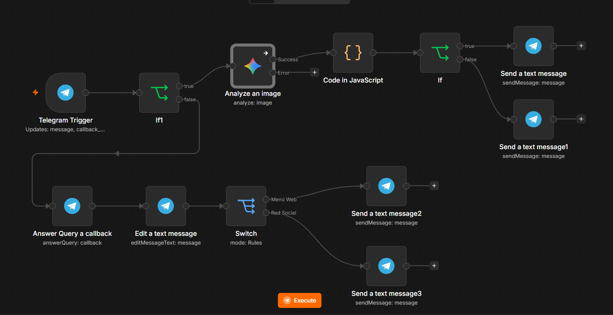

# Documentación de Práctica: Asistente de Marketing Gastronómico

## 1. Descripción General del Proyecto

Este proyecto consiste en un flujo de trabajo automatizado construido en **n8n** que actúa como un **Asistente de Marketing Automatizado para Restaurantes** a través de **Telegram**.

El flujo permite a los usuarios enviar fotografías de platillos y recibir de forma inmediata:

1. Una validación mediante IA (Google Gemini 3.5 Flash Lite) para confirmar si la imagen corresponde a comida.

2. La generación automática de contenido comercial: **Descripción para Menú Web** y **Copy publicitario con hashtags para Redes Sociales**.

3. Botones interactivos (*Inline Keyboards*) para ejecutar acciones directas como publicar en la web o en redes sociales.

4. Gestión de eventos y callbacks en tiempo real con edición dinámica de mensajes para evitar re-clicks o inconsistencias en producción.

## 2. Arquitectura Tecnológica y Herramientas

* **n8n:** Orquestador de flujos de automatización.

* **Telegram Bot API:** Interfaz de comunicación bidireccional y recepción de eventos (*Webhooks*).

* **Google Gemini 1.5 Vision:** Modelo de Inteligencia Artificial para visión computacional y generación de lenguaje natural.

* **JavaScript / Node.js:** Procesamiento intermedio de datos e ingeniería de prompts dentro de n8n.

## 3. Explicación Detallada de la Arquitectura y Diagrama de Flujo

El flujo está estructurado a partir de un **único punto de entrada** (*Telegram Trigger*) para evitar la sobreescritura de Webhooks en Telegram al publicar el flujo en entorno de producción.

```
                               ┌── [TRUE: Es Mensaje / Foto] ──► [Analyze an Image (Gemini)] ──► [Code (JS)] ──► [If: ¿Es Comida?] ──► Enviar Propuesta + Botones
[Telegram Trigger Unificado] ──┤
                               └── [FALSE: Clic en Botón] ─────► [Answer Query] ──► [Edit Text (Quita Botones)] ──► [Switch (Web/Social)] ──► Confirmación

```

### Captura General del Flujo en n8n


## 4. Componentes y Módulos del Sistema

### 4.1. Entrada y Ruteo Inicial

* **Telegram Trigger:** Configurado para escuchar eventos de tipo `message` y `callback_query`.

* **If1 (Ruteador Principal):**

  * Evalúa si la propiedad `{{ $json.message }}` existe (`Object: is not empty`).

  * **Ruta True:** Se envía a la rama de Análisis visual.

  * **Ruta False:** Se redirige a la rama de Interacción de botones (*Callback Query*).

### 4.2. Procesamiento de Imagen e Inteligencia Artificial

* **Analyze an Image (Google Gemini 1.5):** Recibe la imagen adjunta, analiza sus componentes visuales y retorna un análisis descriptivo.

* **Code (JavaScript):** Estructura la respuesta de Gemini y prepara la validación del contenido.

* **If (Validación de Platillo):**

  * Verifica si el contenido analizado corresponde efectivamente a un platillo de comida.

  * **Si NO es comida:** Envía un mensaje informando que solo se aceptan fotografías de platillos.

  * **Si SÍ es comida:** Envía el análisis, los copys generados y añade los botones interactivos:

    * `action_web`: "Agregar a Menú Web"

    * `action_social`: "Publicar en Red Social"

### 4.3. Gestión de Interacciones (Callbacks) y Prevención de Errores

Para garantizar la estabilidad y experiencia de usuario en producción, el flujo implementa la siguiente secuencia al presionar un botón:

1. **Answer Query a callback:** Responde de inmediato a la API de Telegram para desactivar el indicador visual de carga en el botón.

2. **Edit a text message:** Edita el mensaje original eliminado los botones (*Inline Keyboards*) para impedir que el usuario ejecute la misma acción múltiples veces por error.

3. **Switch (Segmentación de Acciones):**

   * Evalúa la propiedad `{{ $('Telegram Trigger').item.json.callback_query.data }}`.

   * **Salida 0 (`action_web`):** Ejecuta la lógica para agregar al Menú Web y notifica al usuario (`Send a text message2`).

   * **Salida 1 (`action_social`):** Ejecuta la publicación en Redes Sociales y notifica al usuario (`Send a text message3`).

